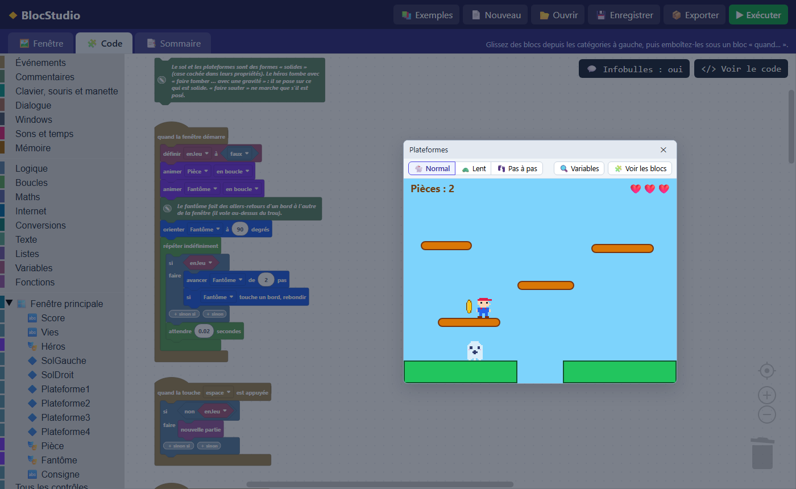

# BlocStudio

**Programmer en blocs, en français, pour fabriquer de vraies applications et des jeux Windows.**

BlocStudio mélange deux idées :
- **dessiner sa fenêtre** comme dans Visual Basic : on pose des boutons, des zones de texte, des images, des sprites… ;
- **écrire ce qu'elle fait avec des blocs** à emboîter, comme dans Scratch : « quand Bouton1 est cliqué », « faire sauter Héros »…

Le résultat s'exporte en **page web** ou en **application Windows (.exe)**, qu'on peut donner à quelqu'un d'autre.



## Démarrer

Rien à installer :

- **`BlocStudio.exe`** (Windows 10 et 11) : l'éditeur dans sa propre fenêtre. Il doit rester à côté de `index.html`. Pour le bureau, faites-en un raccourci.
- ou **`index.html`**, ouvert dans Edge ou Chrome.

Puis **📚 Exemples** pour ouvrir un programme tout fait, ou **📄 Nouveau** pour partir d'une fenêtre vide.

Le projet en cours est gardé automatiquement. **💾 Enregistrer** le met dans un fichier `.bstudio`, que **📂 Ouvrir** relit.

## Ce qu'on peut faire

### Des fenêtres et 38 contrôles

| Thème | Contrôles |
|---|---|
| ✏️ Texte | Étiquette, Lien, Mot de passe, Zone de texte |
| 🔘 Boutons et choix | Bouton, Bouton radio, Calendrier, Case à cocher, Curseur, Interrupteur, Liste déroulante, Sélecteurs de couleur, de date, d'heure et de nombre, Zone de liste |
| 📊 Données | Arborescence, Barre de progression, Base de données, Graphique, Horloge, Tableau |
| 🖼️ Images et dessin | Forme, Image, Sprite (avec son éditeur de dessin en pixels), Zone de dessin |
| 🎬 Sons, vidéos et web | Caméra, Navigateur web, Son, Vidéo |
| 🧱 Mise en page | Barre d'état, Barre d'outils, Cadre, Menu contextuel, Onglets, Panneau défilant |
| ⚙️ Outils | Ouvrir / Enregistrer un fichier, Minuteur |

Un programme peut avoir **plusieurs fenêtres**, des **menus**, des fenêtres **redimensionnables** dont les contrôles suivent leur ancrage, et passer en **plein écran**.

### Plus de 200 blocs

- **Événements** : clics, touches, souris, manette, minuteurs, messages entre les scripts.
- **Mouvement et jeux** : avancer, rebondir, collisions au pixel près, **gravité et saut** avec sols et murs « solides », clones, costumes et animations, **fond qui défile**, score et vies.
- **Manette de jeu** : boutons et joysticks. La croix fait aussi les flèches du clavier, si bien que les jeux prévus pour le clavier se jouent à la manette.
- **Sons** : sons et musiques 8 bits (avec un studio pour les composer), synthèse vocale, **micro**.
- **Données** : listes, **dictionnaires**, mémoire qui reste d'un lancement à l'autre, fichiers CSV lisibles par Excel.
- **Maths et texte** : hasard, nombres écrits à la française (« 1 234,50 »), conversions d'unités, **dates**.
- **Internet et Windows** : météo, données d'un service web, notifications, presse-papiers, impression.

Chaque bloc a une infobulle qui explique à quoi il sert. Le bouton **</> Voir le code** montre le JavaScript produit par les blocs.

### Pour trouver ses erreurs

Les modes **Lent** et **Pas à pas** éclairent chaque bloc au moment où il s'exécute, et **Variables** montre leurs valeurs. Une erreur est expliquée en français, et **🧩 Voir le bloc** désigne le bloc fautif.

### 20 exemples

- **🌱 Pour débuter** : Bonjour, Fiche d'inscription, Quiz de calcul, Compte à rebours, Plusieurs fenêtres.
- **🗂️ Applications** : Liste de tâches, Carnet secret, Bloc-notes, Messagerie, Météo, Carnet d'adresses, Ma bibliothèque.
- **🎮 Jeux** : Balle qui rebondit, Attrape la pièce, Pluie de météorites, Chasse aux fantômes, Casse-briques, Plateformes.
- **🎨 Images, sons et caméra** : Mini-Paint, Photomaton.

Tous sont commentés avec des blocs « 💬 » qui expliquent comment ils marchent.

## Exporter

**📦 Exporter** propose :

- **Page web (.html)** : un seul fichier, qui s'ouvre dans n'importe quel navigateur.
- **Application Windows (.exe)** : un seul fichier, à double-cliquer. Il utilise WebView2, le moteur d'Edge présent sur Windows 10 et 11 : rien d'autre à installer. Le fonctionnement du lanceur est décrit dans [`lanceur/LISEZMOI.md`](lanceur/LISEZMOI.md).

## Organisation du code

| Fichier | Rôle |
|---|---|
| `index.html`, `css/style.css` | La page de l'éditeur |
| `js/app.js` | L'éditeur : concepteur de fenêtres, propriétés, fichiers, exécution, export |
| `js/blocks.js` | Les blocs (forme, infobulle, JavaScript produit) et la boîte à outils |
| `js/runtime.js` | Le moteur qui fait tourner les programmes, dans l'éditeur comme dans les exports |
| `js/exemples.js` | Les exemples de la galerie |
| `js/editeur-sprite.js`, `js/studio-musique.js`, `js/emojis.js` | L'éditeur de sprites, le studio de musique 8 bits, le choix d'émojis |
| `lanceur/` | `BlocStudio.exe` et le lanceur des applications exportées (C#, WebView2) |
| `lib/blockly/` | [Blockly](https://developers.google.com/blockly), la bibliothèque de blocs de Google |
| `tests/` | Les tests automatiques |

Il n'y a pas d'étape de construction : les fichiers sont utilisés tels quels. Seuls `BlocStudio.exe` et le lanceur se recompilent, et seulement si `lanceur/Lanceur.cs` ou `lanceur/Studio.cs` change :

```
powershell -ExecutionPolicy Bypass -File lanceur\construire.ps1
```

Le compilateur C# utilisé fait partie de Windows.

## Tests

```
powershell -ExecutionPolicy Bypass -File tests\verifier.ps1
```

Le script ouvre l'éditeur dans Chrome ou Edge, sans fenêtre, puis vérifie :
- le moteur (gravité, score, dates, dictionnaires, manette…) ;
- chaque exemple : il s'ouvre, ses blocs s'affichent et il s'exécute sans erreur ;
- chaque projet `.bstudio` posé dans `tests\`.

Il répond « Tout est bon » (code de sortie 0) ou liste les échecs (code 1).

## Licence

BlocStudio est sous [licence MIT](LICENSE) : chacun peut l'utiliser, le modifier et le redistribuer librement, à condition de garder la mention de licence.

Les programmes que vous créez avec BlocStudio sont à vous. Une fois exportés, ils contiennent le moteur de BlocStudio (MIT) et, pour un .exe, les DLL WebView2 de Microsoft.

## Logiciels et services utilisés

- [Blockly](https://github.com/google/blockly) 11.2.1 : Google, licence Apache 2.0 (`lib/blockly/LICENSE`).
- Le kit [WebView2](https://developer.microsoft.com/microsoft-edge/webview2/) 1.0.2903.40 : Microsoft, licence de type BSD (`lanceur/sdk/LICENSE.txt`).
- [Open-Meteo](https://open-meteo.com) pour les blocs Météo : données sous licence CC BY 4.0.

Le détail, avec ce que chacun apporte, est dans [LOGICIELS-TIERS.md](LOGICIELS-TIERS.md).
